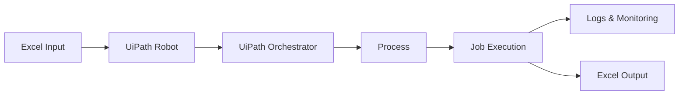

# RPA Process Monitoring using UiPath Orchestrator

## 1. Project Overview
This project is an academic demonstration of UiPath Orchestrator capabilities. It processes a batch of employee records from an Excel input file, applies business validation rules, and generates an output file with processing statuses. The primary goal is to showcase Orchestrator Processes, Jobs, Scheduling, and Logs in a simple and reliable manner.

## 2. Problem Statement
Batch Excel processing is a common business requirement. When these processes run on local machines, it is difficult to monitor failures, track processing history, or schedule executions centrally. This project demonstrates how using RPA (UiPath) and a centralized orchestrator solves these problems by providing clear logs, job history, and automated scheduling.

## 3. Architecture

## 4. Project Structure
- `Main.xaml`: The primary workflow that orchestrates the execution.
- `project.json`: Project configuration and dependencies.
- `Data/Input/EmployeeRecords.xlsx`: The input test data containing valid and invalid records.
- `Data/Output/ProcessedEmployeeRecords.xlsx`: The generated output file after processing.
- `Documentation/Demo_Checklist.md`: A checklist for academic demonstration.

## 5. Workflow
1. **Initialize**: Read configuration and input paths.
2. **Load Excel**: Read all records from the input Excel file into a DataTable.
3. **Process Transactions**: Iterate through each record.
4. **Validate & Log**: Apply validation rules, set the processing status (Success/Failed), and log the result.
5. **Generate Output**: Write the updated DataTable to the output Excel file.

## 6. Input Data
The input Excel file contains the following columns:
- EmployeeID
- EmployeeName
- Department
- Salary
- Status

## 7. Validation Rules
A record is considered valid only if:
1. `EmployeeID` is not empty.
2. `EmployeeName` is not empty.
3. `Department` is not empty.
4. `Salary` is numeric and greater than 0.
5. `Status` is exactly "Active".

## 8. Output
The output Excel file contains the original columns plus:
- `ProcessingStatus`: "Success" or "Failed".
- `ProcessingMessage`: The specific reason for failure, or a success message.
- `ProcessingTimestamp`: The date and time of processing.

## 9. Logging
The automation logs messages that are visible in UiPath Orchestrator:
- **Info**: Process started, Input file loaded, successful transactions, process completed.
- **Warn**: Validation failures or business rule violations (e.g., missing data, inactive status).
- **Error**: System exceptions (e.g., file not found).

## 10. Exception Handling
- **Business/Validation Failures**: Handled gracefully. If a record is invalid, it is marked as "Failed" and the process continues to the next record.
- **System/Unexpected Failures**: If the input file is missing or Excel fails to open, the overall process throws an exception and the Orchestrator Job fails, clearly showing a system error.

## 11. Testing
### Test 1 — All valid
Ensure all records in the input file are valid. Run the process.
**Expected Result**: All transactions succeed, output is generated, Job completes successfully.

### Test 2 — Mixed valid/invalid
Run with the provided test data containing missing IDs, negative salaries, and inactive employees.
**Expected Result**: Valid records succeed, invalid records fail individually with warning logs. The Job completes successfully overall, but the output file shows mixed statuses.

### Test 3 — Missing input file
Rename the input file and run the process.
**Expected Result**: A system exception occurs. The Orchestrator Job status is marked as "Faulted" with an error log.

## 12. Publishing
1. Open the project in **UiPath Studio**.
2. Click **Publish** in the Design ribbon.
3. Choose **Orchestrator Tenant Processes Feed** (or Custom if exporting to a .nupkg file).
4. Click **Publish** and note the package version.

## 13. Orchestrator Setup
1. **Publish Package**: (See Section 12).
2. **Create Process**: Go to Orchestrator -> Automations -> Processes. Click "Add Process", select the published package, and save.
3. **Configure Robot/Machine**: Ensure your local machine is connected to Orchestrator via UiPath Assistant.
4. **Run Job**: Go to Jobs -> Start Job. Select the Process and click Start.
5. **Inspect Logs**: Open the Job details to view Info, Warn, and Error logs for each transaction.
6. **Create Schedule**: Go to Triggers -> Add Trigger. Set a time (e.g., daily at 10:00 AM) and link it to the Process.
7. **Monitor Job**: Use the Orchestrator Dashboard to monitor Job successes, failures, and execution times.

## 14. Demonstration Checklist
Please refer to `Documentation/Demo_Checklist.md` for a concise checklist of steps and screenshots for your academic demo.
